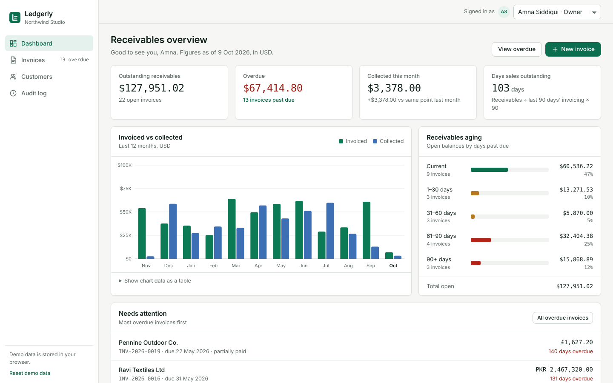

# Ledgerly

Ledgerly is a B2B invoicing and accounts-receivable app for a small studio billing clients in four currencies. It covers the full receivables loop: draft an invoice, send it, record partial and full payments, chase overdue balances, and see where cash stands on a dashboard with DSO and AR aging. Every change is permission-checked and written to an append-only audit log. It is a static site with no backend and no build step: plain HTML, CSS and ES modules, with demo data generated in the browser.

**Live demo:** https://ledgerly-yourname.vercel.app ← update after deploying



## Features

- **Dashboard**: outstanding receivables, overdue amount and count, collected this month, and days sales outstanding. A 12-month invoiced vs collected bar chart (hand-drawn SVG, hover tooltips, table alternative), AR aging buckets, and a "Needs attention" list.
- **Invoices**: search, status multi-select, customer and date-range filters, sortable columns, 25 per page, bulk "Mark as sent" with Undo, CSV export of the selection or of everything that matches the filters. Filter state lives in the URL.
- **Invoice editor**: customer picker with inline "Add customer", currency, payment terms that compute the due date (you can still edit it), reorderable line items with tax and discount, live totals, inline validation that focuses the first invalid field, and a warning before you leave with unsaved changes.
- **Status workflow**: Draft → Sent → Partially paid → Paid. Overdue is derived. Void is Owner-only and needs a reason. Numbers run in sequence per year (`INV-2026-0001`).
- **Invoice detail**: a printable invoice document (Print → Save as PDF gives one clean A4 page), a record-payment dialog that rejects overpayments, payment history, an activity timeline, and Duplicate.
- **Customers**: balances in each customer's own currency, a detail page with their invoices and activity, and add/edit with validation.
- **Roles**: switch between Owner, Accountant and Viewer in the header. Controls you can't use stay visible but disabled, with a tooltip that says which role can use them.
- **Audit log**: filter by user, action and entity; search; pagination; CSV export.
- Light and dark mode, keyboard support, and a layout that works down to 390px wide with a bottom tab bar.

## Architecture

```
index.html          app shell (sidebar, header, tab bar, toast region)
style.css           design tokens, components, responsive and print rules
js/app.js           hash router, shell, unsaved-changes guard
js/store.js         data layer: state, persistence, permissions, audit, metrics
js/permissions.js   role matrix, can()/assertCan(), plain-language denial reasons
js/invoice-math.js  line/total math, derived status, validation, terms
js/format.js        money/date formatting, FX rates, amount parsing
js/seed.js          deterministic demo data (seeded PRNG, dates relative to today)
js/ui.js            dialogs, toasts, permission-aware buttons, CSV, timeline
js/views/*.js       dashboard, invoices, invoice detail, editor, customers, audit, 404
```

- **Data layer.** Views never write state directly. Every mutation in `store.js` runs through `mutate()`, which checks permission, validates, applies the change, appends an audit entry, persists and notifies subscribers. If anything throws, the state rolls back to a snapshot. Storage is localStorage, with every read and write in try/catch and an in-memory fallback, so the app still works in private mode or when storage is blocked.
- **Permissions are enforced in the store.** The UI hides or disables controls, but that's only for usability. `assertCan()` runs inside the store, so calling `voidInvoice()` from the console as an Accountant throws a `PermissionError`.
- **Audit log.** Each entry records who, their role, the action, the entity, a timestamp and a list of before → after field changes. The seed writes audit history that matches the seeded invoices, so the timelines read correctly from the first load.
- **Integer-cents money.** All amounts are integer cents. Line math uses `BigInt`: gross = qty × unit price, then the discount, then tax on the net amount. Each step rounds half-up to the cent, per line. Formatting uses `Intl.NumberFormat` in the invoice's currency. Typed amounts are parsed from strings without going through floats.
- **Derived overdue.** Only `draft`, `sent` and `void` are stored. Partially paid, paid and overdue are computed from payments, the due date and today's date, so an invoice becomes overdue at midnight without any background job.
- **Hash router.** `#/dashboard`, `#/invoices`, `#/invoices/:id`, `#/invoices/:id/edit`, `#/invoices/new`, `#/customers`, `#/customers/:id` and `#/audit` can all be linked, Back works, and unknown routes show a not-found page. List filters and sorting are kept in the query string.
- **Multi-currency.** Invoices are in USD, EUR, GBP or PKR. The dashboard converts to USD using fixed demo rates from a single constant, `FX_RATES_TO_USD`, and the page says so.

## What was interesting to build

- **Rounding that matches an accountant's calculator.** Per-line tax with half-up rounding means the invoice total isn't simply the subtotal times the tax rate. Doing the math in `BigInt` on integer cents and parsing typed amounts as strings avoids errors like `0.1 + 0.2`.
- **Making DSO meaningful.** DSO here is open receivables ÷ credit sales in the last 90 days × 90. Drafts and voids are excluded, and other currencies are converted before summing.
- **Seed data that tells a coherent story.** A seeded PRNG builds 70 invoices over 12 months: each customer has its own payment habits, some invoices take deposits, some are left 90+ days overdue, and two are voided with a reason. The audit entries are generated from the same events, so the dashboard, the lists and the timelines all agree.
- **Unsaved-changes guard on a hash router.** `hashchange` can't be cancelled, so the router puts the previous URL back with `replaceState`, asks for confirmation in a dialog, and then continues to the new URL if you confirm.

## Tech

Vanilla JavaScript (ES modules), HTML and CSS custom properties. No frameworks, no libraries and no build step. Charts are inline SVG. IBM Plex Sans and IBM Plex Mono come from Google Fonts. Tested end to end with Python Playwright (Chromium).

## Run locally

ES modules need to be served over HTTP, so opening the file directly won't work.

```bash
npx serve .
# or
python3 -m http.server 8000
```

Then open the URL it prints. Use **Reset demo data** in the sidebar to start over.

## Deploy to Vercel

1. Push this folder to a GitHub repository.
2. In Vercel, choose **Add New → Project** and import the repository.
3. Leave Framework Preset as **Other**. Leave the build command and output directory empty.
4. Click **Deploy**, then update the live demo link at the top of this README.
